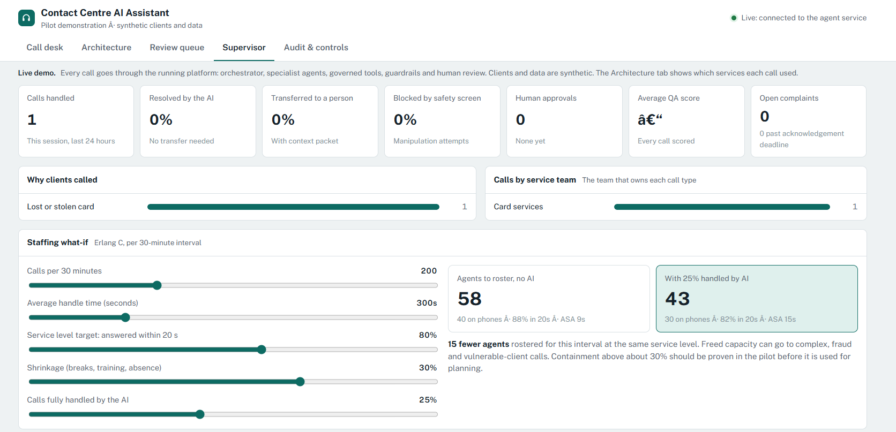

# Contact Centre Agentic AI — reference implementation

An executable, enterprise-shaped agentic AI solution for a bank contact centre:
a **LangGraph** supervisor orchestrating specialist agents, which reach enterprise
systems only through a governed **MCP** tool server, with **RAG**, guardrails,
**human-in-the-loop** approvals, durable encrypted **short- and long-term memory**,
**OpenTelemetry/OpenInference** tracing, **LangSmith** and **Microsoft Foundry**
integration, formal evaluation gates and full Solution Designer documentation.

> **POC only.** Synthetic data, fictional customers and a synthetic knowledge
> base. Not affiliated with, endorsed by, or describing the actual systems or
> policies of bank.

---

## Architecture: five services

```
 Channels (IVR, chat, agent desktop, demo console)
        │  HTTPS + sign-in token
        ▼
 ┌─────────────────┐   checks tokens at the edge, rate limits, strips spoofable headers,
 │ API gateway     │   adds correlation ID + signed proof of entry          services/gateway       :8000
 └────────┬────────┘
          ▼
 ┌─────────────────┐   orchestrator + 6 specialist agents, human review, guardrails,
 │ Agent API       │   memory; accepts /v1 traffic only from the gateway  ccagent/api           :8080
 └────────┬────────┘
          │  MCP (Streamable HTTP) + user delegation token
          ▼
 ┌─────────────────┐   the agents' only route to business systems; client bound by token,
 │ MCP tool service│   per-agent tool allow-lists, approval token for changes  ccagent/mcp_server :8765
 └───┬─────────┬───┘
     │         │   service token (workload identity) + delegation token + approval token
     ▼         ▼
 ┌──────────┐ ┌──────────┐ ┌───────────────┐
 │ Customer │ │ Case     │ │ Knowledge     │   systems of record; each re-checks caller, user,
 │ service  │ │ service  │ │ index         │   purpose and approval independently (zero trust)
 └──────────┘ └──────────┘ └───────────────┘   services/customer_service :8101 · services/case_service :8102
        Shared: encrypted agent state store · hash-chained audit store written by every service
```

Start all five with one command: `python -m scripts.run_all`, then open **http://127.0.0.1:8000/console**.
`uvicorn ccagent.api.app:create_app --factory --port 8080` still runs everything in one process
(tools and data in-process), which is handy for development and tests.

| Gateway policy | Where |
|---|---|
| Route allow-list, deny by default (404) | `services/gateway/app.py` `_routes` |
| Token validation at the edge (Entra ID in prod, dev tokens locally) | `create_app` → `validator.validate` |
| Rate limits per user, and per address on public routes (429) | `TokenBucketLimiter` ×2 |
| Header hygiene: strip `X-Delegation-*`, `X-Approval-*`, `X-Gateway-*`, `X-Forwarded-*`… | `STRIP_PREFIXES` |
| Signed proof of entry (`X-Gateway-Token`, permission `api.ingress`) checked by the agent API | gateway + `ccagent/api/app.py` (`CCAGENT_REQUIRE_GATEWAY`) |
| Upstream 502/504, request size 413, per-route metrics, aggregated health | `/gateway/health`, `/gateway/metrics`, `/gateway/routes` |

| Microservice | Endpoints | Checks on every request |
|---|---|---|
| Customer service | `GET /customers/{ref}/profile`, `GET …/transactions`, `POST …/cards/{id}/lock` | workload permission (`customer.read` / `customer.cards.lock`), delegation token bound to the same client, purpose and step-up, minimised fields, approval token + four-eyes + `Idempotency-Key` for locks |
| Case service | `POST /cases`, `GET /cases`, `GET /cases/{id}` | workload permission (`cases.write` / `cases.read`), client taken from the delegation token, purpose must match case type, approval for large disputes, `Idempotency-Key` |

Workload identity: `ccagent/security/service_tokens.py`. Locally, short-lived signed service tokens;
in Azure (`CCAGENT_SERVICE_AUTH=azure`) managed identities and Entra app roles, with no shared secrets.

## What it does (contact-centre functions)

| Function | How it is handled |
|---|---|
| Product / policy questions | `knowledge_agent` → RAG over approved KB, cited answers, citation verified by the output guard |
| Balance & recent transactions | `account_agent` — only after customer authentication (step-up otherwise); data minimised by purpose |
| Lost / stolen card | `card_agent` proposes a lock → **paused for human review** (four-eyes) → executed idempotently with an approval token |
| Transaction disputes | `dispute_agent` — below threshold executes; at/above `$500` requires reviewer approval; CRM case with SLA |
| Complaints | `complaint_agent` — every expression of dissatisfaction logged as a case with acknowledgement SLA |
| Fraud / scams | `escalation_agent` — P1 warm transfer to fraud queue + fraud referral case; no investigation by AI |
| Vulnerable clients | detected → routed to specialist queue, empathetic language enforced |
| "Talk to a person" / low confidence | warm transfer with a context packet (no re-authentication, no repeating the story) |
| After-call work | automatic wrap-up summary + disposition code, written to long-term memory (redacted) |
| Quality assurance | automated QA scorecard per interaction; low scores flagged for human QA sampling |
| Supervisor KPIs | containment, escalation, guardrail blocks, HITL approval rate, QA, complaint SLA breaches |
| Workforce management | Erlang C staffing calculator incl. AI-containment what-if |
| Audit | tamper-evident hash-chained audit log; auditor-only verification endpoint |

## Requirement → implementation map

| Requirement (from the brief) | Where |
|---|---|
| Replace `MemorySaver` / in-memory `runs` dict; survive restarts; shared across workers | `persistence/checkpoint.py` (AsyncSqliteSaver / AsyncPostgresSaver), `persistence/runs.py` (durable run registry, optimistic concurrency). Test: `test_paused_run_survives_restart_and_resumes_on_new_instance` |
| Durable checkpointer/store with retention & encryption | AES-256-GCM `EncryptedSerializer` (`AESGCMCipher`, key versioning), store TTL + sweeper, `scripts/purge_expired.py`. Test: `test_checkpoints_are_encrypted_at_rest` |
| Replace mock retrieval with Azure AI Search | `integrations/knowledge.py::AzureAISearchRetriever` (hybrid + semantic, security trimming, Entra auth) |
| Real customer lookup with identity, authorization, purpose limitation, audit | `integrations/customer.py` (`_authorize`, `OPERATION_POLICY`, `PROFILE_FIELDS_BY_PURPOSE`, `HttpCustomerService`) |
| Authn/z middleware, secret mgmt, rate limits, structured logs, telemetry, PII controls | `security/auth.py` (Entra JWKS / dev), `secrets.py` (Key Vault), `security/ratelimit.py`, `logging_setup.py`, `telemetry.py`, `security/pii.py` |
| Bounded retries, timeouts, idempotency, output validation, prompt-injection defense, formal evaluation | `resilience.py`, `llm/structured.py`, `Idempotency-Key` + keyed tools, `security/guardrails.py`, `evals/run_eval.py` + `thresholds.json` |
| Protect review/resume so only authorised reviewers approve the correct run | `service.py::submit_review` (role, four-eyes, interrupt id + action hash binding, CAS claim) + approval token verified again by the MCP tool. Test: `test_review_endpoint_is_protected` |
| LangGraph, LangChain, LangSmith, Microsoft Foundry SDK | `agents/graph.py`, LangChain retrievers/models, `service.py` LangSmith tracer + `evals/langsmith_eval.py`, `llm/foundry.py` + `evals/foundry_eval.py` |
| Agent orchestrator + agents | `agents/graph.py` (supervisor + 6 specialists + HITL + responder) |
| MCP | `mcp_server/server.py` (tool server, in-process or Streamable HTTP), `agents/tool_gateway.py` (client) |
| Short- and long-term memory | checkpointer thread state + `trim_messages`; LangGraph store namespaces `("customers", ref, …)` with TTL |
| OpenTelemetry + OpenInference | `telemetry.py` (OpenInference span kinds, `LangChainInstrumentor`), `deploy/otel-collector.yaml`, Phoenix in compose |
| No real customer data | `data/*.json` are synthetic and labelled |

## Stakeholder demo UI

One page, five views: **Call desk** (the call plus a "behind the scenes" panel showing what the AI received,
how it understood and routed the call, the agent path, systems used, knowledge cited, controls applied and the
automatic wrap-up and QA), **Architecture** (the five services with live health, the path the selected call took
through gateway, agent API, MCP tool service and microservices, and gateway traffic), **Review queue** (four-eyes approvals, including a refused self-approval),
**Supervisor** (shift KPIs and an Erlang C staffing what-if) and **Audit & controls** (hash-chained audit trail
per call and a controls-to-regulation map).

* **Live, full architecture:** `python -m scripts.run_all`, then open `http://127.0.0.1:8000/console` (through the gateway). Type your own questions.
* **Live, single process:** `uvicorn ccagent.api.app:create_app --factory --port 8080`, then `http://localhost:8080/console`.
* **Shareable, no setup:** `python -m scripts.record_demo` starts all five services and records every scenario through the gateway, then
  `python -m scripts.build_demo_page` writes `static/demo_page.html`, which replays those recorded runs (`--wrap` to open it straight from disk).
* Talk track: `docs/08-stakeholder-demo-script.md`.

## Quick start

```bash
python -m venv .venv && source .venv/bin/activate
pip install -r requirements.txt
cp .env.example .env            # defaults: offline model, SQLite, dev auth — no cloud needed

pytest -q                       # 81 tests: flows, security, MCP, persistence, API, gateway, microservices, full stack
python -m evals.run_eval        # formal evaluation + release gate (exit 1 on regression)
python -m scripts.demo          # scripted walkthrough of every flow

python -m scripts.run_all       # all five services; open http://127.0.0.1:8000/console
```

Production-shaped container stack (the five services + PostgreSQL + OTel collector + Phoenix; only the
gateway publishes a port): `docker compose up --build`, then `http://localhost:8000/console`.

### API in 4 calls (through the gateway)

```bash
B=http://127.0.0.1:8000
tok(){ curl -s -X POST $B/dev/token -H 'content-type: application/json' -d "{\"persona\":\"$1\"}" | jq -r .access_token; }
IVR=$(tok ivr_authenticated); REV=$(tok reviewer)

R=$(curl -s -X POST $B/v1/interactions -H "Authorization: Bearer $IVR" -H "Idempotency-Key: $(uuidgen)" \
     -H 'content-type: application/json' -d '{"message":"My card was stolen"}')      # → awaiting_review
curl -s $B/v1/reviews/pending -H "Authorization: Bearer $REV"                         # reviewer queue
curl -s -X POST $B/v1/runs/$(echo $R | jq -r .run_id)/review -H "Authorization: Bearer $REV" \
     -H 'content-type: application/json' \
     -d "$(echo $R | jq '{decision:"approve", interrupt_id:.pending_review.interrupt_id, action_hash:.pending_review.action_hash}')"
```

## Switching to Azure (Microsoft Foundry)

```bash
az login
export CCAGENT_LLM_PROVIDER=azure_foundry
export AZURE_AI_FOUNDRY_PROJECT_ENDPOINT=https://<resource>.services.ai.azure.com/api/projects/<project>
export AZURE_OPENAI_DEPLOYMENT=gpt-4o
export CCAGENT_RETRIEVER=azure_ai_search AZURE_SEARCH_ENDPOINT=https://<search>.search.windows.net
export CCAGENT_OTEL_EXPORTER=azure_monitor     # App Insights connection string discovered from the Foundry project
python -m evals.run_eval                        # same release gate against the real model
```

`CCAGENT_ENV=prod` refuses to start with any mock/local component (offline model,
dev auth, SQLite, mock customer API, local KB, no telemetry).

## Layout

```
ccagent/
  agents/        graph.py (orchestrator + agents), state.py, tool_gateway.py (MCP client)
  mcp_server/    server.py (governed enterprise tools), __main__.py (Streamable HTTP)
  integrations/  customer.py, knowledge.py (BM25 + Azure AI Search), cases.py (CRM)
  llm/           offline_model.py, factory.py (Foundry), foundry.py, structured.py, prompts.py
  security/      auth.py, tokens.py, pii.py, guardrails.py, ratelimit.py
  persistence/   checkpoint.py (encrypted), runs.py, audit.py, db.py
  ops/           routing.py, qa.py, workforce.py (Erlang C), kpis.py
  api/app.py     FastAPI; service.py; container.py; telemetry.py; resilience.py
services/
  gateway/          API gateway (edge policies, routing, health, metrics)
  customer_service/ customer system of record (synthetic)
  case_service/     case management (synthetic)
  common.py         shared middleware, error bodies, health/metrics
scripts/         run_all.py (start all five), record_demo.py, build_demo_page.py, demo.py, purge_expired.py
evals/           golden_dataset.jsonl, thresholds.json, run_eval.py, langsmith_eval.py, foundry_eval.py
static/          console.html (demo UI), demo_recording.json, demo_page.html (shareable replay)
docs/            01–08: requirements, architecture + ADRs, integrations, security & governance,
                 delivery plan, runbook & RCA, interview preparation, stakeholder demo script
```

## Verification status (be precise about this in interviews)

* **Verified by running:** the full offline path — LangGraph graph incl. interrupt/resume, encrypted SQLite checkpointer + store, MCP v2 tool server in-process **and** over Streamable HTTP, all five services as separate processes driven through the gateway (including a customer-service outage that degrades to a person), 81 tests, evaluation gate, scripted demo, and the demo UI driven in a headless browser in replay, single-process and full-stack modes.
* **Not run here:** `docker compose` (no Docker in the build environment) and the PostgreSQL code paths; the compose file and SQL dialect handling are written for them but should be smoke-tested on your machine.
* **Written against SDK documentation but not executed here (needs Azure / services):** Azure OpenAI via Foundry, `azure-ai-projects` calls, Azure AI Search REST, Key Vault, Entra ID JWKS validation, Azure Monitor exporter, PostgreSQL saver/store, `azure-ai-evaluation`, LangSmith upload. Confirm API versions against the versions approved in your environment.
* The offline model is deterministic and rule-based; a 100% offline eval score proves the *plumbing and controls*, not model quality. The same gate must be run against the real model before any release.




