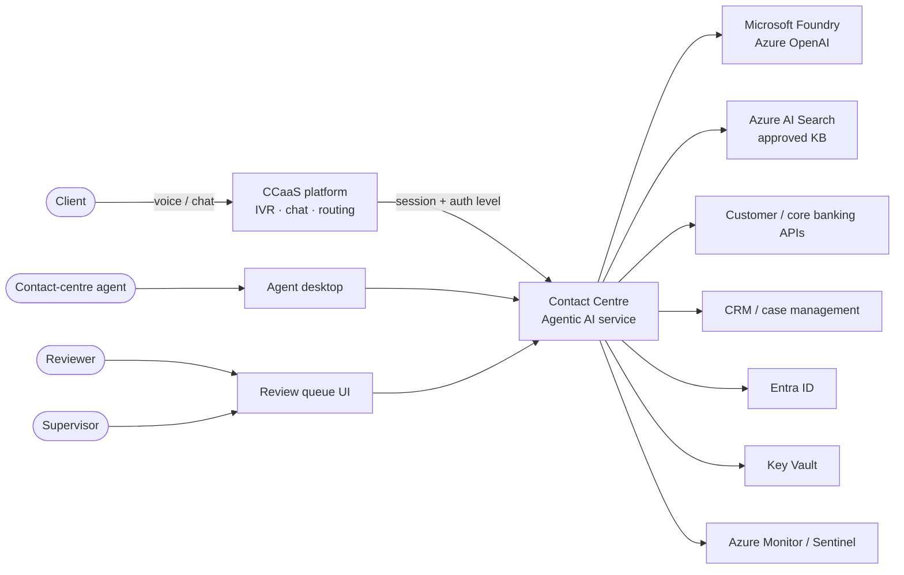
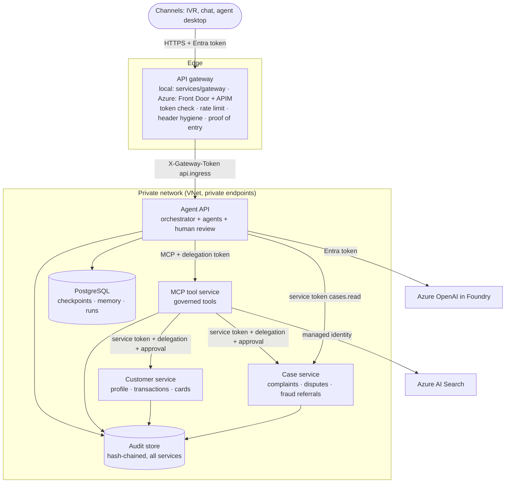
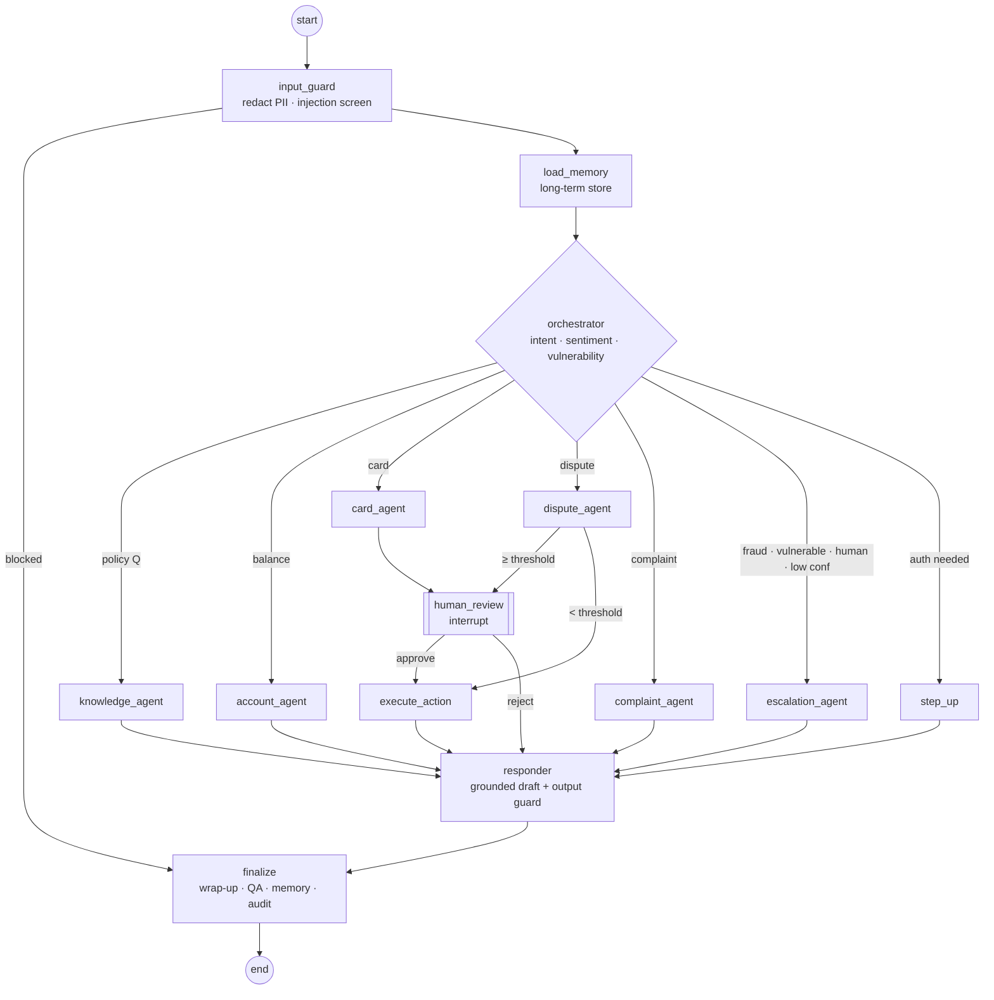
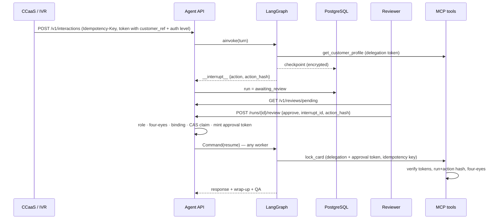

# 02 — Solution Architecture

## 2.1 System context (C4 level 1)

## 2.2 Containers (C4 level 2)

Five deployable services. Locally they run as processes (`python -m scripts.run_all`) or containers
(`docker compose up`); in Azure each is a Container App / AKS workload with its own managed identity.

**Why split this way.** The gateway owns edge policy so channels and the agent evolve independently.
The MCP tool service is the single, reviewable boundary between non-deterministic agents and business
systems. Customer and case services are systems of record: they re-check every credential themselves,
so a defect or compromise upstream cannot widen access (zero trust, defence in depth).

**Workload identity.** Each hop carries a service token for its audience and permission
(`customer.read`, `customer.cards.lock`, `cases.write`, `cases.read`, `api.ingress`), plus the end user's
delegation token and, for state changes, the reviewer's approval token. Local tokens are short-lived
signed JWTs; in Azure they are managed-identity tokens validated against Entra app roles.

## 2.3 Agent graph

## 2.4 Card lock sequence (HITL)

## 2.5 Design decisions (ADRs)

| ADR | Decision | Rationale | Alternatives considered |
|---|---|---|---|
| 001 | LangGraph supervisor + specialist nodes (explicit graph), not a free-form ReAct agent | Deterministic, auditable control flow; HITL via `interrupt`; per-node least privilege | Single ReAct agent (less predictable), Foundry Agent Service (strong option; kept as hosting alternative) |
| 002 | All enterprise access via an MCP tool server | One governed boundary; reusable across agents/channels; separately deployable and auditable | Direct SDK calls from agents |
| 003 | Identity, customer binding and purpose come from verified tokens, never from LLM output | Neutralises prompt-injection attempts to switch customer or escalate privilege | Trusting tool arguments |
| 004 | High-risk actions require a reviewer approval token bound to run id + action hash | Four-eyes, tamper-evident, replay-safe | Approval flag in state |
| 005 | Durable PostgreSQL checkpointer + store; app-level AES-GCM encryption | Restart-safe, multi-worker, DB operators cannot read content | In-memory, Redis |
| 006 | Hybrid + semantic retrieval with security trimming in Azure AI Search | Best recall on policy text; audience/classification filters | Vector-only |
| 007 | Bounded retries only for transient errors; idempotency keys on all writes; circuit breakers → human fallback | Avoids duplicate actions and retry storms | Client-library default retries |
| 008 | Structured JSON outputs validated by Pydantic + correction retry | Machine-checkable outputs; failures become fallbacks not hallucinations | Free text parsing |
| 009 | Offline deterministic model for CI | Reproducible tests and control verification without data leaving the bank | Recorded fixtures only |
| 010 | OpenInference conventions on OTel spans; LangSmith via anonymising client | Vendor-neutral tracing; no raw PII in third-party tools | Proprietary tracing only |
| 011 | API gateway as the only ingress; agent API verifies a signed proof of entry | Edge policy in one place; a header alone can't fake the path | Network rules only (no defence if misconfigured) |
| 012 | Systems of record re-verify workload, user and approval tokens | A compromised or buggy upstream can't widen access | Trusting the MCP layer's checks |
| 013 | One shared hash-chained audit store, each record labelled with its service | A complete, verifiable trail per call across services | Per-service logs joined later in the SIEM |

## 2.6 Memory design
* **Short-term (session):** LangGraph checkpoint per `thread_id` (one contact). Messages trimmed to the
  last N before each model call. Encrypted, TTL-purged.
* **Long-term (client):** LangGraph store, namespace `("customers", <customer_ref>, "interactions" | "preferences")`.
  Only redacted summaries, intents, dispositions and case ids. Read only when the caller is authenticated.
  Native TTL (default 90 days, configurable to the retention schedule).
* **Run registry:** relational table — status, pending review, reviewer, metrics (not conversation content).

## 2.7 RAG design
Ingestion (owned by Knowledge Management): approved documents → chunking (by section) → integrated
vectorisation → index with `audience`, `classification`, `owner`, `effective_date`. Query: hybrid + semantic
ranker, filter by audience and classification. Post-retrieval: indirect-injection filter, spotlighting
delimiters. Generation: facts + documents only; citations required; output guard verifies citations ⊆ retrieved IDs.
Freshness: `effective_date` surfaced; stale-content report to KB owners.

## 2.8 Guardrail layers
1. Edge: WAF, APIM JWT + rate limits, payload limits.
2. Input: PII redaction, injection/jailbreak screening (+ optional Azure AI Content Safety Prompt Shields).
3. Structural: tool allow-list per agent, token-bound identity/customer/purpose, approval tokens.
4. Retrieval: security trimming + poisoned-chunk filtering.
5. Output: schema validation, PII check, prohibited statements (advice, guarantees, refund promises), citation check.
6. Fallback: any failure → safe message + warm transfer.

## 2.9 Fallback matrix

| Failure | Detection | Behaviour |
|---|---|---|
| LLM timeout / 5xx | `call_with_resilience` | 1 retry, then safe fallback + transfer |
| Invalid model JSON | Pydantic validation | Up to 3 attempts with correction prompt, then fallback |
| Search unavailable / no grounding | empty retrieval | Transfer with context (no ungrounded answer) |
| Tool error / circuit open | tool result / breaker | Transfer; action not retried unless keyed |
| A microservice is down | connection error → `unavailable` → bounded retries | Safe message + transfer; other paths (e.g. knowledge answers) keep working. Tested in `test_customer_service_outage_degrades_to_a_person` |
| Request bypasses the gateway | missing / invalid `X-Gateway-Token` | 403 `gateway_required` at the agent API |
| Output guard violation | `validate_output` | Replace with safe message, audit, transfer |
| Whole-turn timeout | `graph_timeout_s` | Run marked failed, safe message, transfer |
